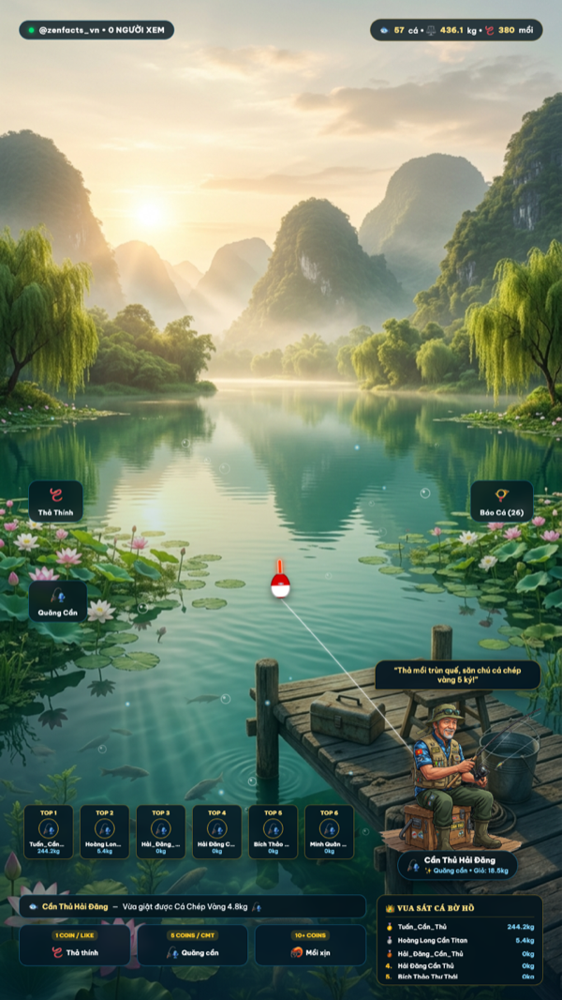
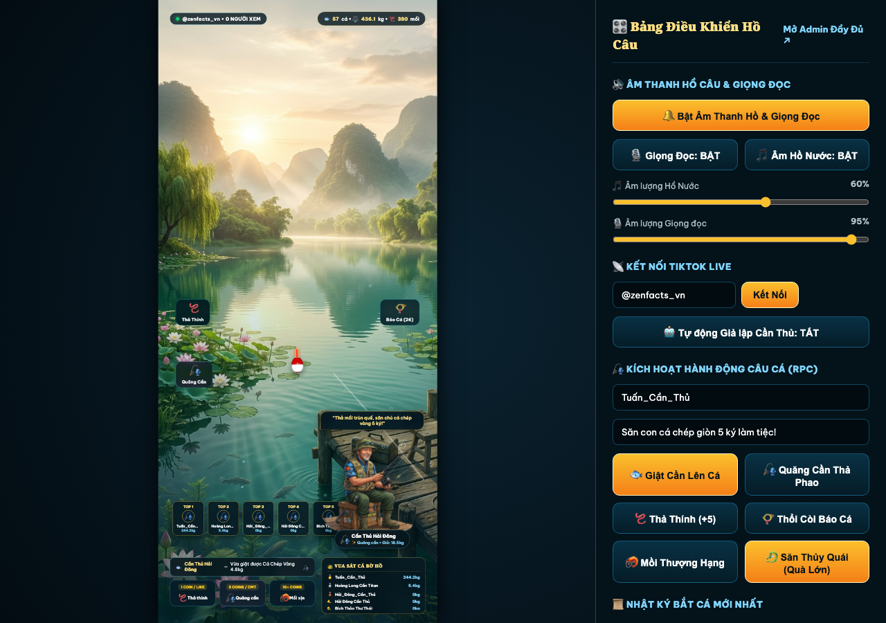
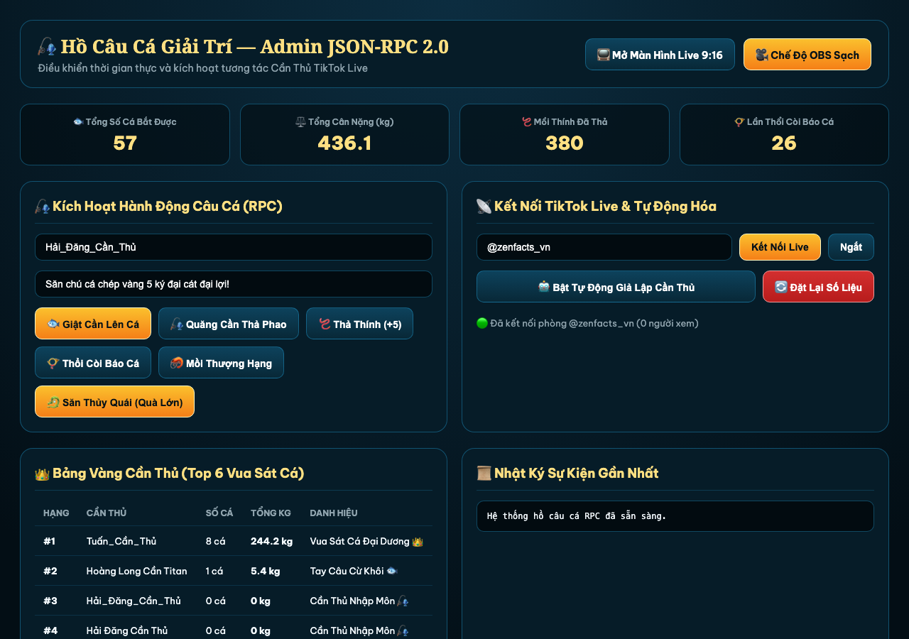

# 🎣 Hồ Câu Cá Giải Trí Online — TikTok Live RPC (9:16 Interactive Fishing Stream)

Hệ thống phát trực tiếp tương tác (**Interactive TikTok Live Stream & JSON-RPC 2.0**) chuẩn khung dọc **9:16 (`1080×1920`)** dành cho **OBS Studio / TikTok Live Studio**, chạy siêu nhẹ trên **Bun.js** và tích hợp giọng đọc AI tiếng Việt **ZeroTTS (`zeroweight-ai/ZeroTTS`)**.

Người xem trên TikTok Live tương tác trực tiếp qua **Thả tim (Like)**, **Bình luận (Comment)**, **Chia sẻ / Follow** và **Tặng quà (Gift)** để buông cần câu cá trên màn hình Hồ Nước Sơn Thủy Hữu Tình:
- 🪱 **Thả Thính Dụ Cá (Like / Thả tim)**: Ném thính thơm tõm xuống nước, sủi bọt tăm và thu hút đàn cá tụ lại quanh phao câu.
- 🎣 **Quăng Cần & Thả Phao (Bình luận `quăng cần`, `câu cá`, `thả câu`)**: Cần thủ vung cần vút gió ra giữa hồ, phao câu nhấp nhô theo làn sóng nước.
- 🐟 **Giật Cần Bắt Cá (Bình luận `giật cần`, `lên cá`, `cá to`, `bắt cá`)**: Phao câu chìm giật rung bần bật, kéo vút cá lên khỏi mặt nước kèm hiển thị **Thẻ Chiến Tích Bắt Cá** (loài cá, cân nặng, độ hiếm) và giọng đọc AI thông báo chúc mừng!
- 📯 **Thổi Còi Báo Cá (Follow / Share hoặc bình luận `thổi còi`)**: Tiếng còi bến tàu vang rền, đàn cá nhảy vọt lên khỏi mặt nước.
- 🦐 **Mồi Thượng Hạng (Tặng quà 5–99 xu)**: Dùng mồi câu xịn bắt ngay các loài cá Cực Phẩm (Cá Koi Ngũ Sắc, Cá Trê Hoàng Kim, Cá Tầm Hoàng Gia...).
- 🐉 **Đại Chiến Thủy Quái (Tặng quà ≥ 100 xu)**: Kéo lên huyền thoại **Cá Rồng Kim Long Quá Bối** hoặc **Thủy Quái Hồ Sâu (Cá Hô 88kg)**, hiệu ứng bão bọt nước và bảng vinh danh toàn màn hình!
- 👑 **Bảng Vàng Cần Thủ (Vua Sát Cá & 6 Ghế Câu VIP)**: Tự động xếp hạng Top cần thủ có tổng cân nặng cá và chiến tích cao nhất trên 6 ghế câu ven hồ.

---

## 📸 Ảnh Chụp Màn Hình

| Màn hình OBS sạch 9:16 (`/?obs=1`) | Màn hình Live + Điều khiển nhanh (`/`) |
| :---: | :---: |
|  |  |

**Bảng điều khiển Admin & RPC (`/admin`)**



---

## ⚡ Kiến Trúc & Tối Ưu Hóa Hiệu Suất (Siêu Nhẹ CPU/GPU)

- **Runtime**: Chạy trực tiếp trên **Bun.js** (`~0.1% CPU` khi chờ).
- **Canvas Particle Engine (`public/js/particles.js`)**:
  - Khóa tốc độ vẽ ở **30 FPS** ổn định, tự động tạm dừng khi ẩn tab (`document.hidden`).
  - Pre-render toàn bộ Bong bóng nước, Gợn sóng elip 2.5D, Giọt nước bắn và Bóng cá ra Offscreen Canvas 1 lần duy nhất lúc khởi tạo.
- **ZeroTTS Worker (`tts_worker.py`)**:
  - Tiến trình Python thường trú nạp sẵn model `zeroweight-ai/ZeroTTS` giọng Mai Chi hào sảng.
  - Tổng hợp nguyên câu trong 1 lần gọi, chuẩn hóa âm lượng và fade mượt mà.
- **Bảo Vệ WebSocket & Chặn Crash**:
  - Bắt lỗi toàn cục `process.on('uncaughtException')` và bảo vệ WebSocket client không bị sập khi TikTok Live ngắt kết nối.

---

## 🚀 Hướng Dẫn Cài Đặt & Chạy Nhanh

### 1. Yêu cầu hệ thống
- [Bun.js](https://bun.sh/) (`>= 1.1`)
- Python `3.10+` & [`uv`](https://github.com/astral-sh/uv)

### 2. Cài đặt thư viện
```bash
# Cài đặt dependencies cho Bun / Node
bun install

# Cài đặt ZeroTTS vào môi trường ảo
uv pip install --python .venv/bin/python zerotts pillow
```

### 3. Khởi chạy Server
```bash
bun start
# Hoặc chế độ tự động reload khi sửa code:
bun run dev
```

Mặc định server chạy tại cổng `3000`:
- **Màn hình Live 9:16 + Điều khiển nhanh**: [http://localhost:3000](http://localhost:3000)
- **Màn hình OBS Browser Source (Sạch 9:16)**: [http://localhost:3000/?obs=1](http://localhost:3000/?obs=1) *(Đặt kích thước Browser Source trong OBS là `1080 × 1920`)*
- **Bảng điều khiển Admin & RPC**: [http://localhost:3000/admin](http://localhost:3000/admin)

---

## 🎮 Bảng Quy Tắc Tương Tác TikTok Live

| Sự kiện TikTok Live | Từ khóa / Điều kiện | Hành động trên Hồ Câu | Điểm Cần Thủ |
| :--- | :--- | :--- | :---: |
| **Thả tim (Like)** | Mỗi đợt thả tim | Ném mồi thính sủi bọt nước dụ đàn cá tụ lại | `+1` / tim |
| **Follow / Share** | Theo dõi hoặc chia sẻ | Thổi còi bến tàu ngân vang + Cá nhảy tung tăng | `+15` |
| **Bình luận Thả Thính** | `thả thính`, `mồi`, `thính` | Ném 5 nắm thính thơm xuống nước | `+5` |
| **Bình luận Quăng Cần** | `quăng cần`, `câu cá`, `thả câu` | Vung cần xé gió, phao câu rơi xuống hồ | `+5` |
| **Bình luận Giật Cần** | `giật cần`, `lên cá`, `cá to`, `bắt cá` | Giật cần, kéo lên chú cá ngẫu nhiên + Mở thẻ cá + Đọc TTS | Theo độ hiếm cá |
| **Bình luận Thủy Quái** | `thủy quái`, `cá rồng`, `kim long` | Thử vận may săn cá quý hiếm hoặc cực phẩm | Theo loài cá |
| **Tặng quà Nhỏ (1–4 xu)** | Hoa hồng, Heart Me... | Chắc chắn câu được Cá Quý Hiếm (Chép Vàng, Cá Tra...) | `+20` / xu |
| **Tặng quà Vừa (5–99 xu)** | Nước hoa, Mũ, Cà phê... | Dâng Mồi Thượng Hạng -> Bắt Cá Cực Phẩm (Cá Koi, Cá Tầm...) | `+30` / xu |
| **Tặng quà Lớn (≥ 100 xu)** | Quà ≥ 100 xu | **Đại Chiến Thủy Quái**: Kéo lên Cá Rồng Kim Long / Thủy Quái 88kg | `+50` / xu |

---

## 🔌 Giao Thức JSON-RPC 2.0 (`POST /rpc` & `ws://localhost:3000/ws`)

### 1. Giật cần bắt cá
```bash
curl -X POST http://localhost:3000/rpc \
  -H "Content-Type: application/json" \
  -d '{
    "jsonrpc": "2.0",
    "id": 1,
    "method": "fishing.hookFish",
    "params": {
      "user": "Hải Đăng Cần Thủ",
      "wish": "Săn cá chép giòn 5 ký!"
    }
  }'
```

### 2. Thả thính dụ cá
```bash
curl -X POST http://localhost:3000/rpc \
  -H "Content-Type: application/json" \
  -d '{
    "jsonrpc": "2.0",
    "id": 2,
    "method": "fishing.castBait",
    "params": {
      "user": "Tuấn Cần Thủ",
      "count": 5
    }
  }'
```

### 3. Săn Thủy Quái (Quà Lớn)
```bash
curl -X POST http://localhost:3000/rpc \
  -H "Content-Type: application/json" \
  -d '{
    "jsonrpc": "2.0",
    "id": 3,
    "method": "fishing.catchLeviathan",
    "params": {
      "user": "Đại Cần Thủ VIP",
      "coins": 199
    }
  }'
```

---

## ⚠️ Disclaimer (Miễn Trừ Trách Nhiệm)

- **Không liên kết chính thức**: Dự án này là sản phẩm độc lập, **không liên kết, không được tài trợ hay chứng thực** bởi TikTok, ByteDance hay bất kỳ bên thứ ba nào được nhắc đến. Tên và thương hiệu thuộc về chủ sở hữu tương ứng.
- **Kết nối TikTok Live không chính thức**: Dự án dùng thư viện cộng đồng [`tiktok-live-connector`](https://github.com/zerodytrash/TikTok-Live-Connector) (không phải API chính thức). Thư viện có thể ngừng hoạt động bất cứ lúc nào và việc sử dụng có thể vi phạm Điều khoản dịch vụ của TikTok. **Bạn tự chịu trách nhiệm và rủi ro** (bao gồm hạn chế hoặc khóa tài khoản).
- **Chỉ phục vụ giải trí**: Cá, điểm số, bảng xếp hạng và "quà tặng" trong game chỉ mang tính giải trí, **không phải trò chơi cờ bạc hay may rủi ăn tiền** và không có giá trị quy đổi thành tiền hay phần thưởng thực tế. Vui lòng tuân thủ quy định về quà tặng ảo và quảng cáo của TikTok tại quốc gia của bạn.
- **Giọng đọc AI & tài nguyên**: Mô hình ZeroTTS, hình ảnh, âm thanh và các thư viện đi kèm thuộc bản quyền của chủ sở hữu tương ứng. Hãy kiểm tra giấy phép trước khi sử dụng cho mục đích thương mại.
- **Không bảo hành**: Phần mềm được cung cấp **"nguyên trạng" (as is)**, không kèm bất kỳ bảo đảm nào. Tác giả không chịu trách nhiệm cho bất kỳ thiệt hại hay hậu quả nào phát sinh từ việc sử dụng dự án.
